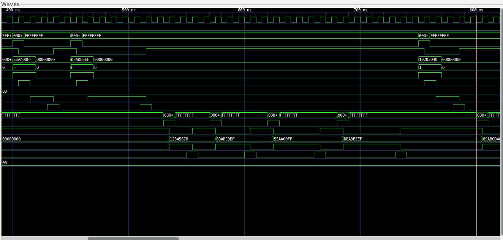
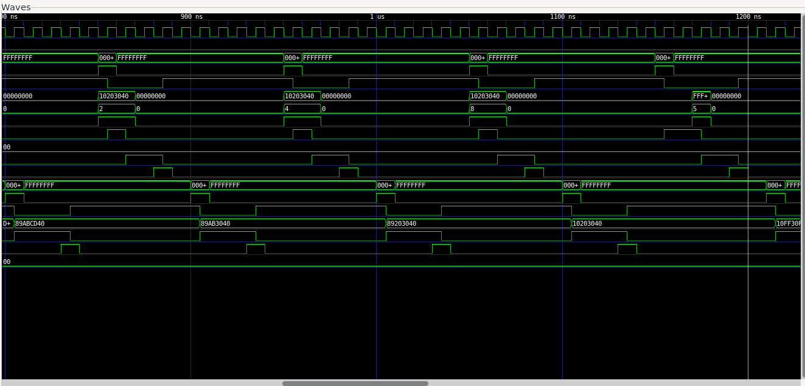
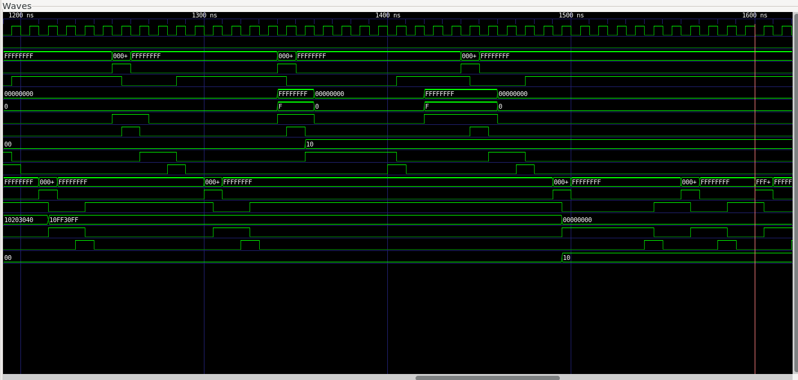

# AXI4-Lite Slave RTL Design

A synthesizable **AXI4-Lite slave** written in Verilog HDL. An AXI master, such as a processor, can write to four memory-mapped registers and read their values back. The project shows how a peripheral captures bus requests, selects a register from a byte address, and returns a response even when the master needs extra cycles to accept it.

## 📌 Features

- 32-bit address and data buses in the default configuration.
- Four 32-bit read/write registers, each cleared to zero by reset.
- Five channels with `VALID`/`READY` handshakes and separate read and write control paths.
- One outstanding read and one outstanding write. The read and write paths can operate concurrently.
- Byte-selective writes through the four `WSTRB` bits.
- `OKAY` responses for valid accesses and `SLVERR` responses for misaligned or out-of-range addresses.
- A self-checking testbench with Verilator simulation and VCD waveform output.

## 🏗️ AXI4-Lite Architecture

```text
                    AXI4-Lite Master
                          │
        ┌─────────────────┼─────────────────┐
        │                 │                 │
        ▼                 ▼                 ▼
   Write Address      Write Data       Read Address
     AWADDR             WDATA             ARADDR
     AWVALID            WVALID            ARVALID
     AWREADY            WREADY            ARREADY
        │                 │                 │
        └─────────────────┼─────────────────┘
                          │
                    AXI4-Lite Slave
                          │
                    Register Bank
                          │
             ┌────────────┴────────────┐
             ▼                         ▼
        Write Response              Read Data
          BRESP                     RDATA
          BVALID                    RVALID
          BREADY                    RREADY
```

The master sends write addresses, write data, and read addresses. The slave returns write responses and read data. Each channel's receiver drives `READY` back to its sender. All five channels use the rising edge of `clk`.

## 🔄 AXI4-Lite Handshake

A channel transfers its payload on a rising clock edge when both `VALID` and `READY` are high. The sender asserts `VALID` when its payload is available and holds both `VALID` and the payload steady until the transfer. The receiver asserts `READY` when it can accept the payload.

```text
VALID = 1
READY = 1
```

| Channel | Sender | Payload | Handshake signals |
|---|---|---|---|
| `AW` | Master | Write address (`AWADDR`) | `AWVALID`, `AWREADY` |
| `W` | Master | Write data and byte enables (`WDATA`, `WSTRB`) | `WVALID`, `WREADY` |
| `B` | Slave | Write response (`BRESP`) | `BVALID`, `BREADY` |
| `AR` | Master | Read address (`ARADDR`) | `ARVALID`, `ARREADY` |
| `R` | Slave | Read data and response (`RDATA`, `RRESP`) | `RVALID`, `RREADY` |

The RTL uses lowercase signal names with an `s_` prefix, such as `s_awvalid`. The testbench uses names such as `awvalid` for its corresponding connections.

## ✍️ Write Transaction

```text
Master                         Slave
  │                              │
  │───── AWADDR + AWVALID ───────>│
  │<──────── AWREADY ────────────│
  │                              │
  │───── WDATA + WVALID ─────────>│
  │<──────── WREADY ─────────────│
  │                              │
  │<──────── BVALID + BRESP ─────│
  │────────── BREADY ───────────>│
  │                              │
```

1. In `WR_IDLE`, the slave asserts `AWREADY`. The `AW` handshake saves the address in `wr_addr_q` and advances the controller to `WR_DATA`.
2. In `WR_DATA`, the slave asserts `WREADY`. The master may assert `WVALID` before, alongside, or after `AWVALID`. If data arrives early, the master holds it until `WREADY` goes high and the `W` handshake occurs.
3. On the `W` handshake, a valid address selects a register and each asserted `WSTRB[n]` writes byte `WDATA[8*n +: 8]`. A zero strobe leaves the register unchanged and returns `OKAY` for a valid address. An invalid address leaves the bank unchanged and returns `SLVERR`.
4. In `WR_RESP`, the slave holds `BVALID` and `BRESP` steady until the master accepts the response with `BREADY`. The controller then returns to `WR_IDLE`.

For example, writing `0x10203040` with `WSTRB = 0b0001` to a register containing `0x89ABCDEF` changes only its least significant byte. The next read returns `0x89ABCD40`.

## 📖 Read Transaction

```text
Master                         Slave
  │                              │
  │───── ARADDR + ARVALID ───────>│
  │<──────── ARREADY ────────────│
  │                              │
  │<──────── RDATA + RVALID ─────│
  │────────── RREADY ───────────>│
  │                              │
```

1. When reset is low and no read response is pending, the slave asserts `ARREADY`.
2. On the `AR` handshake, the slave decodes the address and registers the response. A valid address returns the selected word with `RRESP = 2'b00` (`OKAY`). An invalid address returns zero with `RRESP = 2'b10` (`SLVERR`).
3. The slave holds `RDATA`, `RRESP`, and `RVALID` steady until the master accepts the response with `RREADY`. While the response is pending, `ARREADY` stays low.

## 🧠 Register Map

All four words are general-purpose, read/write storage. The offsets below are the byte addresses presented at the slave interface.

| Byte offset | Register | Access | Reset value |
|---|---|---|---|
| `0x00` | `REG0` (`reg_file[0]`) | Read/write | `0x00000000` |
| `0x04` | `REG1` (`reg_file[1]`) | Read/write | `0x00000000` |
| `0x08` | `REG2` (`reg_file[2]`) | Read/write | `0x00000000` |
| `0x0C` | `REG3` (`reg_file[3]`) | Read/write | `0x00000000` |

An address is valid when its low two bits are zero and its value is below `0x10`. Bits `[3:2]` select one of the four words. For example, `0x01` fails the alignment check and `0x10` falls outside the register window.

## 🔧 Internal Architecture

```text
                 AXI4-Lite Slave
                       │
        ┌──────────────┴──────────────┐
        │                             │
   Write Controller             Read Controller
        │                             │
        ▼                             ▼
   Address Decode               Address Decode
        │                             │
        └──────────────┬──────────────┘
                       │
                       ▼
                  Register Bank
```

| RTL block | Role |
|---|---|
| Write FSM (`wstate`) | Moves through `WR_IDLE`, `WR_DATA`, and `WR_RESP` as the `AW`, `W`, and `B` handshakes complete. |
| Address decode | Checks the saved write address or incoming read address and extracts the register index. |
| Register bank (`reg_file`) | Stores four words and updates the enabled byte lanes on a valid write. |
| Read response logic | Registers data and status on the `AR` handshake and uses `s_rvalid` to track a pending response. |
| Reset logic | The active-high asynchronous `reset` clears the register bank, clears both response-valid flags, and returns the write FSM to `WR_IDLE`. |

If a read address handshake and a write to the same register occur on the same rising edge, the RTL captures the register's pre-write value for that read.

The module declares `ADDR_WIDTH`, `DATA_WIDTH`, and `NUM_REGS` parameters. The four-bit write strobe and address decoder are tied to the default 32-bit data and four-register layout. Changing that layout requires corresponding RTL changes.

## 🧩 Main RTL Components

| File | Role |
|---|---|
| [`axi_lite_slave.v`](RTL/axi_lite_slave/axi_lite_slave.v) | Synthesizable `axi_lite_slave` module containing the register bank, address decoder, write FSM, and read response logic. |
| [`tb_axi_lite.v`](RTL/axi_lite_slave/tb_axi_lite.v) | Self-checking `tb_axi_lite` module that drives the bus and checks responses and register contents. |
| [`run.sh`](RTL/axi_lite_slave/run.sh) | Builds and runs the testbench with Verilator and prints the waveform path. |

## 🧪 Verification

The directed testbench drives requests on falling clock edges and samples handshakes on rising edges. A software-style reference model tracks each register's expected bytes. The testbench checks returned data and response codes, and uses timeouts to flag a stalled handshake.

| Scenario | What the testbench checks |
|---|---|
| Reset and recovery | All four registers read as zero after reset, pending responses clear, and new accesses succeed. |
| Write channel timing | Address-first, data-first, and simultaneous `VALID` assertions complete successfully. |
| Byte strobes | Single-byte, mixed-byte, and zero-strobe writes preserve the expected register contents. |
| Response backpressure | With `BREADY` or `RREADY` held low, response signals remain stable until accepted. |
| Invalid accesses | Misaligned and out-of-range transactions return `SLVERR`, invalid reads return zero, and valid register contents survive invalid writes. |
| Concurrent access | A read and a write to different registers can overlap. |

### Simulation Example

Run from the repository root in Bash on Linux or WSL. The script requires Verilator with `--binary` and `--timing` support, plus `make` and `g++`.

```bash
bash RTL/axi_lite_slave/run.sh
```

A successful run prints `PASS: 42 checked transactions`. Each run creates a fresh build directory and prints the path to its `dump.vcd`. To have the script open the waveform when GTKWave is installed, use the optional flag.

```bash
bash RTL/axi_lite_slave/run.sh --waves
```

## 📊 Verification Flow

```text
RTL
 │
 ▼
Testbench
 │
 ▼
AXI Write Transaction
 │
 ▼
Register Update
 │
 ▼
AXI Read Transaction
 │
 ▼
Read Data Verification
 │
 ▼
Waveform Analysis
```

The captures below show the waveform pane. To follow the transactions with signal names visible, open the generated VCD in GTKWave and expand `tb_axi_lite`. The testbench drives the address bus to `FFFFFFFF` after each address handshake to check that the slave uses the accepted address. Read the address at the rising edge where its `VALID` and `READY` signals are both high.

### Full-word write and readback



Between roughly 530 and 700 ns, the read data trace shows `12345678`, `89ABCDEF`, `55AA00FF`, and `DEADBEEF` in register order. Follow `rvalid` and `rready` to find the clock edge where each word is accepted.

### Byte-selective writes



The testbench writes `0x10203040` to `REG1` one byte at a time. The visible readbacks progress from `89ABCD40` to `89AB3040`, `89203040`, and finally `10203040`. A later write of all ones with strobe `0x5` selects lanes 0 and 2, giving `10FF30FF`.

### Invalid addresses



The response traces switch from binary `00` (`OKAY`) to `10` (`SLVERR`) for the invalid requests. The read data trace shows `00000000` during the invalid read responses.

## 🛠️ Tools & Technologies

- **HDL and design level** — Verilog RTL for a memory-mapped peripheral.
- **Bus protocol** — AMBA AXI4-Lite.
- **Simulation** — Verilator and a directed, self-checking testbench.
- **Waveform inspection** — GTKWave with VCD traces.
- **Hardware targets** — FPGA or ASIC integration.

## 📂 Project Structure

```text
.
├── README.md
├── RTL/
│   └── axi_lite_slave/
│       ├── axi_lite_slave.v
│       ├── tb_axi_lite.v
│       └── run.sh
└── tb_Rersult/
    └── tb_Result1.png through tb_Result6.png
```

## 🎯 Learning Outcomes

- Connect a memory-mapped register bank to the five AXI4-Lite channels.
- Use `VALID`/`READY` handshakes to handle independent request timing and response stalls.
- Decode byte addresses into register indices and use write strobes to update individual bytes.
- Model transaction state in synthesizable RTL and inspect it in waveforms.
- Build a self-checking testbench for successful accesses, error responses, and reset recovery.

## 🚀 Future Improvements

- Build an AXI4-Lite master to exercise the slave in a larger system.
- Make address decoding, write strobe width, and register count scale together with the configuration.
- Add peripheral functions such as control/status fields and interrupt generation.
- Integrate with custom IP or a RISC-V SoC and demonstrate the design on an FPGA.
- Add SystemVerilog Assertions for channel timing and expand coverage with UVM-based verification.

## 👨‍💻 Purpose

Focused on **RTL Design, Design Verification, FPGA, ASIC Design and Physical Design**.
